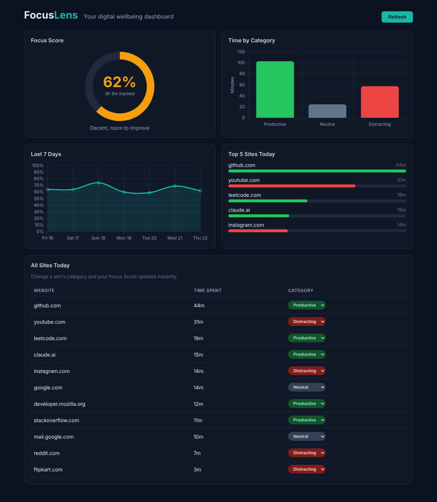

# FocusLens – Digital Wellbeing Tracker

FocusLens is a full-stack application that tracks how much time you spend on each website, classifies that time as **productive**, **neutral** or **distracting**, and shows a daily **Focus Score** on an interactive dashboard.

It has three parts that work together:

| Folder | What it is | Tech |
|---|---|---|
| `extension/` | Chrome extension that tracks time on the active tab | Chrome Manifest V3, JavaScript |
| `backend/` | REST API that stores the time and computes the score | Node.js, Express |
| `frontend/` | Analytics dashboard | React, Vite, Chart.js |



---

## Features

- **Automatic time tracking** – the extension records time on the active tab, pauses when the browser loses focus or you're idle for 1 minute, and saves every minute.
- **Offline-safe** – if the backend is down, the extension queues the data and sends it later.
- **Focus Score gauge** – today's score out of 100, colour-coded green, amber or red.
- **Time by category** – bar chart of productive, neutral and distracting minutes.
- **7-day trend** – line chart of your Focus Score over the past week.
- **Top 5 sites** – where most of your time went today.
- **Editable categories** – reclassify any site from the dashboard and the score recalculates instantly.
- **Extension popup** – see today's score without opening the dashboard.

## How the Focus Score works

```
Focus Score = (productive time + 0.5 × neutral time) / total time × 100
```

Productive time counts fully, neutral time (search, email) counts half, and distracting time counts zero.

Example: 100 min productive, 20 min neutral, 60 min distracting → (100 + 10) / 180 × 100 = **61%**.

## Architecture

```
 Chrome Extension                Backend (Express)             Dashboard (React)
 ───────────────                 ─────────────────             ─────────────────
 background.js  ──POST /api/log──▶  stores seconds per   ◀──GET /api/stats───  Score, charts,
 (tab + idle events)               site per day             GET /api/history   top sites, table
 popup.js       ──GET /api/stats─▶  computes Focus Score ◀──POST /api/categories─ category dropdown
```

## API Endpoints

| Method | Endpoint | Description |
|---|---|---|
| `POST` | `/api/log` | Log time on a site. Body: `{ "domain": "github.com", "seconds": 60 }` |
| `GET` | `/api/stats?date=YYYY-MM-DD` | Focus Score, category totals, top sites and all sites for a day (default today) |
| `GET` | `/api/history` | Focus Score for each of the last 7 days |
| `GET` | `/api/categories` | User's custom site categories |
| `POST` | `/api/categories` | Set a site's category. Body: `{ "domain": "reddit.com", "category": "distracting" }` |

## Getting Started

**Requirements:** Node.js 18 or newer and Google Chrome (or Edge).

### 1. Clone the repository

```bash
git clone https://github.com/Saad-kunjan/FocusLens.git
cd FocusLens
```

### 2. Start the backend

```bash
cd backend
npm install
npm run seed   # optional: loads 7 days of sample data for a demo
npm start      # runs on http://localhost:5000
```

### 3. Start the dashboard

Open a second terminal:

```bash
cd frontend
npm install
npm run dev    # opens on http://localhost:5173
```

### 4. Load the Chrome extension

1. Go to `chrome://extensions`
2. Turn on **Developer mode** (top right)
3. Click **Load unpacked** and select the `extension` folder
4. Pin the FocusLens icon and start browsing. Your time appears on the dashboard within a minute.

## Project Structure

```
FocusLens/
├── backend/
│   ├── server.js          # Express API and Focus Score logic
│   ├── db.js              # JSON file datastore
│   ├── categories.js      # default site categories
│   └── seed.js            # sample data generator
├── frontend/
│   └── src/
│       ├── App.jsx
│       ├── api.js
│       └── components/    # ScoreCard, CategoryChart, TrendChart, TopSites, SitesTable
├── extension/
│   ├── manifest.json
│   ├── background.js      # tracks the active tab
│   ├── popup.html
│   └── popup.js
└── docs/screenshots/
```

## Future Scope

- Blocking or warning on distracting sites after a daily limit
- User accounts so data syncs across devices
- Weekly email summary of focus trends
- Firefox support
